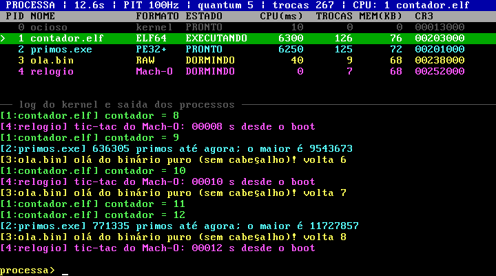

# PROCESSA

Mini sistema operacional x86-64 feito do zero que carrega programas do disco em
**qualquer um de quatro formatos de executável** e alterna entre eles usando a
**interrupção do timer de hardware** (multitarefa preemptiva).

Não usa bibliotecas: sem libc, sem bootloader pronto (GRUB/Limine), sem
cabeçalhos do sistema (`-nostdinc -nostdlib`). Tudo, do setor de boot ao
`printf`, está neste repositório. Usamos só as ferramentas de compilação
(gcc, nasm, ld, objcopy) e um script Python que monta a imagem de disco.



## O que o desafio pede e onde está

| Requisito | Implementação |
|---|---|
| Definir o que é um processo | `struct process` (o PCB) em [kernel/proc/process.h](kernel/proc/process.h): pid, estado, registradores salvos, tabela de páginas própria (CR3), pilha de kernel, tempo de CPU |
| Ler vários processos / carregar do disco | driver de disco ATA ([kernel/drivers/ata.c](kernel/drivers/ata.c)) + sistema de arquivos PROCFS ([kernel/fs/procfs.c](kernel/fs/procfs.c)) + loader ([kernel/loader/loader.c](kernel/loader/loader.c)) |
| Qualquer formato binário | o loader descobre o formato pelos **primeiros bytes do arquivo** (número mágico), não pela extensão: **ELF64** (Linux), **PE32+** (Windows), **Mach-O 64** (macOS) e **binário puro**. Cada formato é um módulo em [kernel/loader/](kernel/loader/) |
| Arquitetura de 64 bits | o setor de boot leva a CPU do modo real (16 bits) direto ao modo longo (64 bits): [boot/boot.asm](boot/boot.asm) |
| Alternar usando o driver do timer | driver do PIT 8254 ([kernel/drivers/pit.c](kernel/drivers/pit.c)) gera a IRQ0 100x por segundo; a cada tick o escalonador round-robin ([kernel/proc/sched.c](kernel/proc/sched.c)) decide se troca de processo, e a troca acontece em [kernel/arch/isr.asm](kernel/arch/isr.asm) |

Também tem:

- **Isolamento de memória:** cada processo tem a sua própria tabela de páginas e roda em anel 3 (modo usuário).
- **Chamadas de sistema** via `int 0x80`.
- **Painel ao vivo** com os PCBs, o tick do timer e a fatia de tempo restante do processo na CPU.
- **Shell** com os comandos `ls`, `run`, `kill`, `ps`, `info`, `trace`, `quantum`, `freq` e `mem`.

## Como compilar e rodar

### Opção A: WSL (Ubuntu)

```bash
sudo apt install build-essential nasm python3 qemu-system-x86
make run        # compila e abre o QEMU
```

### Opção B: Windows com Docker Desktop + QEMU para Windows

```powershell
.\build.ps1                                          # compila dentro de um container Ubuntu
winget install SoftwareFreedomConservancy.QEMU       # uma vez só
.\run.ps1                                            # abre o QEMU com a imagem
```

Outros alvos: `make test` roda 20 s sem janela e mostra o log serial; `make clean` apaga `build/`.

### Opção C: num PC de verdade, por pendrive

A mesma imagem dá boot direto num computador, sem sistema operacional nenhum por baixo.

1. **Grave `build\processa.img` no pendrive** com o [Rufus](https://rufus.ie) (ele detecta a imagem e grava em modo DD) ou com o balenaEtcher.
   - **Isso apaga tudo o que estiver no pendrive.**
   - Depois da gravação, o Windows pode pedir para "formatar o disco": **cancele**.
2. **Na configuração da BIOS do PC, habilite o boot "Legacy" / "CSM".** Normalmente é preciso desligar o Secure Boot antes. O setor de boot do PROCESSA é do tipo BIOS (MBR), não UEFI.
3. **Ligue pelo menu de boot** (F12, F9, F8 ou Esc, conforme a marca) e escolha o pendrive na entrada **sem** "UEFI:" no nome.

**Como os programas são lidos do pendrive:**
- O kernel não tem driver USB (um controlador xHCI + armazenamento USB do zero é um projeto à parte). Por isso o setor de boot pede à BIOS, que sabe ler o pendrive, para copiar a área de arquivos (PROCFS) para a memória em `0x30000`.
- O kernel procura um disco ATA. Se não encontrar, ou se o PROCFS não estiver nele, usa essa cópia. O log do boot mostra qual fonte foi usada.
- Cabem até 384 KiB de arquivos.

**Se o chip do timer estiver desligado:** alguns chipsets modernos desligam o PIT. Nesse caso o kernel avisa em vermelho no boot, porque sem ele os processos não se alternam.

### Escrevendo um programa novo

Crie um arquivo `.c` em `user/` e compile normalmente. Ele entra no disco sozinho como `<nome>.elf`:

```c
/* user/oi.c */
#include "processa.h"

int main(void)
{
    printf("oi! sou o PID %ld\n", sys_getpid());
    for (int i = 1; i <= 5; i++) {
        printf("volta %d de 5\n", i);
        sys_sleep(1000);
    }
    return 0;
}
```

```powershell
.\build.ps1        # ou: make
.\run.ps1          # no PROCESSA: run oi.elf
```

O programa só tem o que está em [user/include/processa.h](user/include/processa.h):

- `printf`, `print`, `strlen`, `memset` e `memcpy`;
- as chamadas de sistema `sys_getpid`, `sys_sleep`, `sys_uptime`, `sys_yield` e `sys_exit`.

Ele não lê o teclado, não usa ponto flutuante e não tem `malloc`.

### Colocando arquivos prontos no disco

Para colocar qualquer arquivo no disco virtual, use a variável `ARQUIVOS`:

```bash
make run ARQUIVOS="extras/prog.elf extras/outro.bin"        # WSL
.\build.ps1 -Arquivos "extras\prog.elf extras\outro.bin"     # Windows (depois .\run.ps1)
```

- Os arquivos entram no disco com o mesmo nome (sem a pasta) e não iniciam no boot: rode com `run <nome>`.
- No Windows, eles precisam estar dentro da pasta do projeto, porque é ela que o container do Docker enxerga.
- Nomes com espaço não são aceitos.

## Comandos (digite na linha `processa>`)

| Comando | O que faz |
|---|---|
| `ls` | lista os arquivos do disco e o formato detectado de cada um |
| `run <arquivo>` | carrega o arquivo do disco e cria um processo novo (pode repetir) |
| `kill <pid>` | encerra um processo |
| `ps` | imprime a tabela de processos e a fila de prontos (ordem do round-robin) |
| `info <pid>` | mostra o PCB inteiro: registradores salvos, pilha de kernel, CR3 e faixas de memória mapeadas |
| `trace on\|off` | registra cada troca de contexto: tick, quem saiu, quem entrou, o motivo, onde parou e onde retoma (rip) |
| `saida on\|off` | esconde/mostra a saída dos processos na tela (eles continuam rodando; o log serial recebe tudo) |
| `quantum <n>` | muda a fatia de tempo (em ticks do timer) |
| `freq <hz>` | reprograma o chip do timer (19 a 1000 Hz) |
| `mem` | mostra a memória física em uso |
| `limpar` | limpa o log |

## Programas de exemplo (no disco)

| Arquivo | Formato | Comportamento |
|---|---|---|
| `contador.elf` | ELF64, gerado pelo gcc/ld | gasta CPU sem parar e nunca devolve a CPU; só a interrupção do timer o tira da CPU |
| `primos.exe` | PE32+, convertido pelo objcopy | calcula primos por 30 s (só CPU) e termina sozinho |
| `ola.bin` | binário puro, sem cabeçalho | imprime e dorme 1,5 s (estado DORMINDO) |
| `relogio` | Mach-O 64, cabeçalho escrito à mão em assembly | imprime o tempo desde o boot a cada 2 s; não tem extensão, o kernel reconhece pelo conteúdo |

## Como funciona

```
BIOS -> boot.asm (16 bits) -> modo longo (64 bits) -> kmain()
  kmain: GDT/TSS, IDT, PIC, memória, timer, teclado, disco, PROCFS
         carrega os programas do disco -> PCBs no estado PRONTO
         liga as interrupções e vira o processo ocioso (PID 0)

a cada IRQ0 do timer (10 ms):
  isr.asm salva os registradores do processo atual na pilha de kernel dele
  isr_handler -> sched_tick(): acabou a fatia? -> schedule():
      atual vira PRONTO, o próximo vira EXECUTANDO
      TSS.rsp0 = pilha de kernel do próximo; CR3 = tabela de páginas do próximo
  isr.asm troca o RSP para o contexto do próximo, restaura os registradores, iretq
  -> o próximo processo continua exatamente de onde parou
```

### Mapa de memória de cada processo

| Faixa | Conteúdo |
|---|---|
| `0x00000000 - 0x3FFFFFFF` | kernel (compartilhado, só acessível em anel 0) |
| `0x40000000 - 0x7FFEFFFF` | código e dados do programa |
| `0x7FFF0000 - 0x7FFFFFFF` | pilha do processo |

### Layout do disco

| Setor (LBA) | Conteúdo |
|---|---|
| 0 | setor de boot, com uma partição ativa que cobre o resto do disco (para a BIOS aceitar dar boot pelo pendrive) |
| 1 | kernel |
| 2048 | diretório PROCFS |
| 2056+ | arquivos |

## Estrutura

```
boot/boot.asm          setor de boot: modo real -> modo longo, carrega o kernel
kernel/
  arch/                entrada 64 bits, GDT/TSS, IDT, stubs de interrupção (troca de contexto)
  drivers/             PIT (timer), PIC, ATA (disco), teclado, VGA, serial
  mm/                  memória física (bitmap) e virtual (paginação de 4 níveis)
  fs/                  PROCFS (diretório simples no disco)
  loader/              ELF64, PE32+, Mach-O 64, binário puro
  proc/                PCB, escalonador round-robin, chamadas de sistema
  lib/                 memset/memcpy/printf próprios
  ui.c shell.c         painel e linha de comando
  kernel.c             kmain
user/                  programas de exemplo + crt0 + mini biblioteca própria
tools/mkdisk.py        monta a imagem de disco
```

## Limitações conhecidas

- **Uma CPU só**, e o kernel roda com as interrupções desligadas, então não precisa de travas (locks).
- **Sem ponto flutuante nos processos.** O kernel não salva os registradores FPU/SSE na troca, por isso tudo é compilado com `-mgeneral-regs-only`.
- **Até 16 processos.** A memória de processos tem 62 MiB, entre 2 e 64 MiB; o QEMU roda com 128 MiB.
- **ELF:** só executável estático (`ET_EXEC`).
- **PE:** sem importação de DLLs e carregado no `ImageBase`, sem realocação.
- **Mach-O:** executável x86-64 (`MH_EXECUTE`).
- **Teclado:** layout US.
